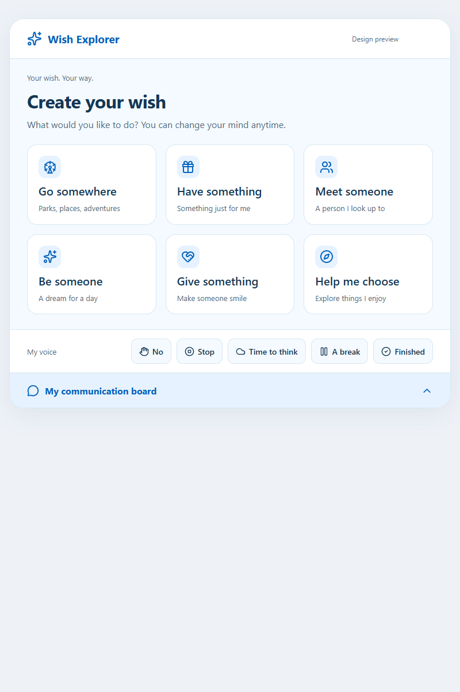
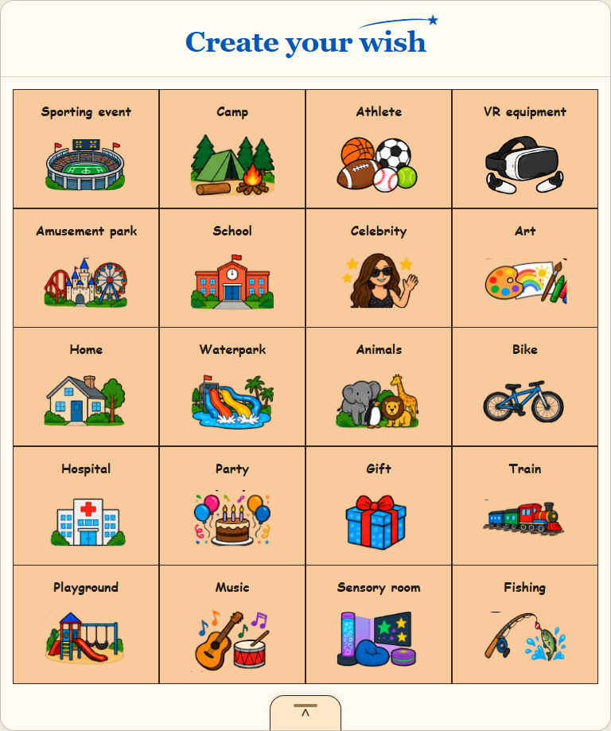
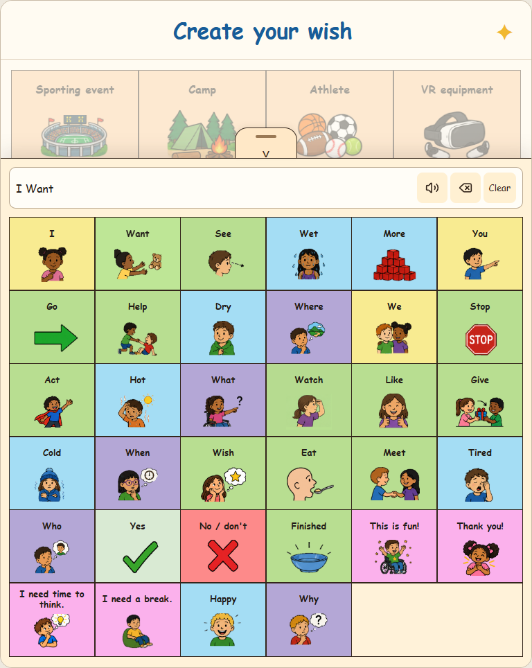

# Wish Explorer preview and image API

A stateless Node service with two separate routes: the existing deterministic SVG preview and optional authenticated AI scene generation. Neither route stores wishes or images, opens an account, or accepts a child's name, photo, precise location, or health information. Connection metadata, including an IP address, is temporarily retained for rate limiting; hosting and AI services have their own processing and retention settings described below.

The new action-led journey supports all 20 interests. Picture choices represent concepts: the app sends their catalog IDs, and the server combines the corresponding reviewed descriptions into one scene prompt. This is not pixel blending or an upload of the original pictograms. Source guides/PDFs, typed communication-board phrases, names, private notes, and the device photo library are never sent to this endpoint.

The current child-facing design starts with **20 picture tiles for interests** and a centered bottom drawer containing **34 core communication concepts**. The earlier six-panel verb menu is archived documentation, not the current home screen. See [UX components and design history](docs/ux-components.md) for the picture-tile layout, drawer behavior, reusable components, and archived screenshot. There is no separate “My voice” quick toolbar or duplicate category menu in the revised design.

## Archived six-panel idea

The original six-panel concept is retained here as design history. The current app uses the illustrated picture board documented above.



The revised picture board and its open drawer:





These screenshots show the interactive browser concept. They do not represent a verified native iPad build.

## Run locally

Requires Node 22 or newer. From this folder:

```powershell
npm start
```

Run `npm ci` first to install the pinned AI SDK dependency. The service binds only to `http://127.0.0.1:8787` by default. Run `npm test` for API/validation tests and `npm run check` for syntax checks. From a repository checkout, `npm run catalog:check` also verifies the deployable catalog mirror; after editing shared `assets/journey-catalog.json`, run `npm run catalog:sync`.

## Optional combined AI scene

`GET /v1/scene-capabilities` returns nonsecret availability information. `enabled: false` and `mode: "offline-only"` mean the app should retain its local picture collage. A successful health check does not establish that generation, billing, or data handling has been verified.

`POST /v1/wish-scene` requires `Content-Type: application/json`, `Authorization: Bearer <grown-up access code>`, and exactly these five fields:

```json
{
  "interestId": "camp",
  "actionIds": ["camp-explore", "camp-stars"],
  "settingId": "camp-yosemite",
  "favoriteIds": [],
  "essentialChoiceId": "camp-stars"
}
```

Use IDs from the shared journey catalog. Actions must belong to the selected topic (maximum three); setting is one of that topic's settings or `null`. Favorites are up to ten distinct supported IDs. `essentialChoiceId` must identify an already-selected action, setting, or favorite, or be `null`. Unknown fields, free text, mixed-topic choices, duplicates, and unselected essentials are rejected before an AI call. All choices may be skipped; the selected topic still supplies the scene idea.

Success has the same five outer keys as the legacy response: `id`, `title`, `description`, `image`, and `provider`. Here `image.mimeType` is PNG, JPEG, or WebP, and **`image.data` is base64 raster data**, unlike the legacy route's SVG source. Provider is `Google Vertex AI via Vercel AI Gateway`. The title and description are assembled from the reviewed catalog, not arbitrary AI text. Each result has a fresh random ID unrelated to a user. Images are limited to 2.8 MiB before base64 encoding, keeping the response below Vercel's 4.5 MB body limit. Images are held only while returning the response; there is no image URL, storage bucket, database, or server history.

The adapter calls the installed AI SDK's real `generateText` API. The model ID must be configured explicitly. On November 11, 2026 the live catalog and endpoint metadata verified `google/gemini-nano-banana-2.1` with image output and a Vertex endpoint offering zero data retention and no training. Model availability must be checked again before activation. Every request pins `only: ["vertex"]`, `zeroDataRetention: true`, and `disallowPromptTraining: true`. It explicitly requests `responseModalities: ["IMAGE"]` and a 1K, 4:3 image. These controls fail if no matching provider is available; there is no fallback to a provider with weaker handling. SDK telemetry and automatic retries are disabled. Prompts request a single generic, child-appropriate illustrated scene without identifiable people, brands, sponsor commitments, or unsafe behavior. No provider safety settings are weakened.

Generation is **off by default**. To activate, an operator must supply all of:

- `SCENE_GENERATION_ENABLED=true`.
- `SCENE_ACCESS_TOKEN`, a securely generated 32–256 character non-whitespace ASCII access code (the server and app enforce 32–256 UTF-8 bytes). Configure it as a sensitive server variable and enter it through grown-up app Settings; never embed it in source or the app bundle. This access code protects one service, not an individual child account. Replace it if disclosed.
- `AI_GATEWAY_MODEL`, an exact supported Google multimodal image-output model ID verified in the current catalog.
- AI Gateway authentication: Vercel supplies the current OIDC token on each Function invocation; the AI SDK resolves it automatically without an environment token or API key. The deployed `VERCEL=1` runtime is accepted as this credential path; actual generation still verifies authentication with Gateway. For local/other hosting use a server-only `AI_GATEWAY_API_KEY` or locally pulled `VERCEL_OIDC_TOKEN`. The app never receives an AI provider credential.

Gateway credentials, credits, team eligibility for zero data retention, spending limits, provider access, and actual live generation must be verified before enabling the app's online flag. Do not disable ZDR to make a first request work. This repository does not purchase credits, create a paid plan, set a billing budget, or include a working access token.

The native app must show the exact selected concepts and provider to a grown-up and obtain permission for **each** call. Closing that flow, editing selections, leaving the app, or cancelling invalidates it. The server aborts provider work on client disconnect or its 95-second deadline and discards late results. An in-process generation bucket permits three authorized requests per minute, with at most two simultaneous jobs. These limits reset on restart and do not coordinate between replicas: configure ingress limits and a project/Gateway budget before public activation. They are not a financial spending cap.

Controlled errors include `unauthorized` (401), `invalid_choices` (400), `generation_busy` (429), `generation_refused` (422), `generation_unavailable` (503), `generation_timeout` (504), and `generation_failed`/`image_too_large` (502). Provider authentication failure maps to `generation_not_authorized`, missing credits/allowance to `generation_budget_unavailable`, and provider access refusal to `generation_access_denied`; these three return 503 with fixed operator guidance. Errors never return provider exceptions, tokens, prompts, response bodies, or model text. A retry must be a new explicit grown-up action, not an automatic background request.

For Vercel use **`backend` as the project root**, Framework `Other`, and the included `vercel.json`. It installs with `npm ci`, bundles the catalog mirror, and rewrites `/health` and `/v1/*` to one Node function with cancellation support and a 120-second maximum. After deploying, verify the actual rewritten paths, disabled capabilities, unauthorized requests, approved generation, cancellation, and logging/budget configuration. No live image call is part of automated tests.

Privacy and release review must include the app → operator backend → Vercel AI Gateway → Google Vertex AI data flow, network metadata, host logging settings, provider agreements, grown-up permission, output review, and any subsequent sharing. ZDR routing is a provider constraint, not proof that every infrastructure log is erased or that the app qualifies for a particular legal/App Store audience. The local collage remains usable when online generation is unavailable or refused.

Official references: [AI SDK Google options](https://ai-sdk.dev/providers/ai-sdk-providers/google), [Gateway image generation](https://vercel.com/docs/ai-gateway/modalities/image-generation/ai-sdk), [Gateway ZDR](https://vercel.com/docs/ai-gateway/security-and-compliance/zdr), [Gateway no-training control](https://vercel.com/docs/ai-gateway/security-and-compliance/disallow-prompt-training), and [Vercel function limits](https://vercel.com/docs/functions/limitations).

The native app can use an HTTPS deployment URL later. A device cannot reach the computer's loopback address. Use the app's local illustrated postcard for the first demo; do not weaken App Transport Security to make an unencrypted production connection work.

## Contract

`GET /health` returns `{ "status": "ok", "service": "wish-explorer", "version": "0.1.0" }`.

`GET /v1/catalog` returns supported choices for the legacy SVG preview API and its earlier five-verb taxonomy plus the `explore` helper. That response is retained for client compatibility; it is **not the current 20-tile home-screen or action-journey definition**. `explore` / **Help me choose** is navigation, not another official wish category. Only `go` supports the legacy `/v1/wish-preview` endpoint. The new `/v1/wish-scene` uses the separate shared journey catalog and supports all 20 interests. Legacy destination choices do not establish availability or eligibility. Animal choices express imagination, not a claim that a specific animal lives at a selected park.

`POST /v1/wish-preview` requires `Content-Type: application/json` and exactly these four fields:

```json
{
  "categoryId": "go",
  "destinationId": "six-flags-great-america",
  "coasterColor": "blue",
  "animalIds": ["giraffe", "tiger"]
}
```

- `destinationId`: `six-flags-great-america`, `disney-world`, `universal-orlando`
- `coasterColor`: `blue`, `pink`, `purple`, `green`
- `animalIds`: zero to three distinct choices from `giraffe`, `dolphin`, `tiger`

The response is:

```json
{
  "id": "wish_<stable hash>",
  "title": "My wish: Six Flags Great America",
  "description": "I wish to go to ...",
  "image": { "mimeType": "image/svg+xml", "data": "<svg ...>...</svg>" },
  "provider": "illustrated-demo"
}
```

`image.data` contains SVG source, not a URL or base64 string. iOS does not natively load SVG into `Image`; keep the SwiftUI postcard, or add a reviewed rendering/export path later. Use the returned description for the optional API integration. The ID depends on the choices, not a user identity. Unknown fields are rejected. Do not add free text, identifiers, photos, or health fields without redesigning consent, retention, and access controls.

Errors use `{ "error": { "code": "...", "message": "..." } }`. Invalid choices or JSON return 400; oversized payloads 413; unsupported types/encodings 415; disallowed browser origins 403; excess requests 429 with `Retry-After`; incorrect methods 405. There is no query-string API.

## Configuration

Settings are environment variables; `.env` files are not read automatically. `.env.example` documents all names.

| Setting | Default | Purpose |
| --- | --- | --- |
| `HOST` | `127.0.0.1` | Interface to listen on; Docker sets `0.0.0.0` inside its container |
| `PORT` | `8787` | Listening port |
| `CORS_ALLOWED_ORIGINS` | empty | Comma-separated exact browser origins, no wildcard or trailing slash |
| `MAX_BODY_BYTES` | `2048` | Request-body limit, 128 to 65536 |
| `RATE_LIMIT_MAX` | `60` | Requests per connection address per window |
| `RATE_LIMIT_WINDOW_MS` | `60000` | Window length in milliseconds |
| `RATE_LIMIT_MAX_CLIENTS` | `10000` | Bound on temporary rate-limit entries |

Requests without an `Origin` header, including native URLSession requests, pass the origin check. CORS is browser policy, not authentication. Health, catalog, capabilities, and the legacy fixed-choice SVG preview are public; `/v1/wish-scene` separately requires the grown-up's bearer access code. No cookies are used. The API intentionally provides no accounts, database, uploads, or personal-data endpoints.

## Deployment preparation

```powershell
docker build -t wish-explorer-api .
docker run --rm -p 127.0.0.1:8787:8787 wish-explorer-api
```

The image runs as the `node` user and has a health check. Keep a reverse proxy or managed ingress in front of any hosted deployment, terminate HTTPS there, set the intended browser origins, and set request/body/rate limits at ingress. The process handles SIGINT/SIGTERM and closes idle connections. Its local rate limit uses the actual socket address and deliberately ignores `X-Forwarded-For`; behind a proxy, callers may share one bucket. Configure trusted proxy-aware limits at ingress before public use. In-memory limits reset on restart and do not coordinate across replicas.

No wish payloads are written to disk or application request logs. The limiter temporarily retains raw connection addresses, request counts, and reset times in process memory. Each entry's window starts on its first request; the default is 60 seconds. Scheduled cleanup runs every `min(RATE_LIMIT_WINDOW_MS, 1000)` milliseconds, even while the service is idle. In normal operation an expired entry is removed within one cleanup interval (at the default, about 60–61 seconds after its first request). Timer execution depends on the Node event loop, so a stalled/suspended process can delay deletion; this is not a hard wall-clock erasure guarantee. Closing the server stops the timer and clears all entries. The timer is unref'd so it cannot keep an otherwise idle Node process running.

This metadata exists beyond the individual request: the online configuration must not be described as “no data collected” solely because it has no database. A hosting provider/reverse proxy can also log addresses, paths, and headers independently. Verify its retention and logging settings, update the user-facing privacy notice, and review the actual deployed data flow before completing App Store privacy answers. Health checks do not consume rate limits. Public usage still needs ingress abuse protection, monitoring, dependency/image updates, organizational approval, accessibility testing with users, a privacy review, and an operational owner. Nothing here is a booking, medical, eligibility, or Make-A-Wish submission service.

The supplied Make-A-Wish guides inform the prototype. Source picture artwork may be reused in the current local prototype at the user's direction. The legacy API draws its own SVG postcard; the optional AI route sends only reviewed concept descriptions to its provider. Neither serves or uploads the original PDFs or source-art image files. The prototype is not affiliated with, approved by, or a fulfillment promise from Make-A-Wish.
