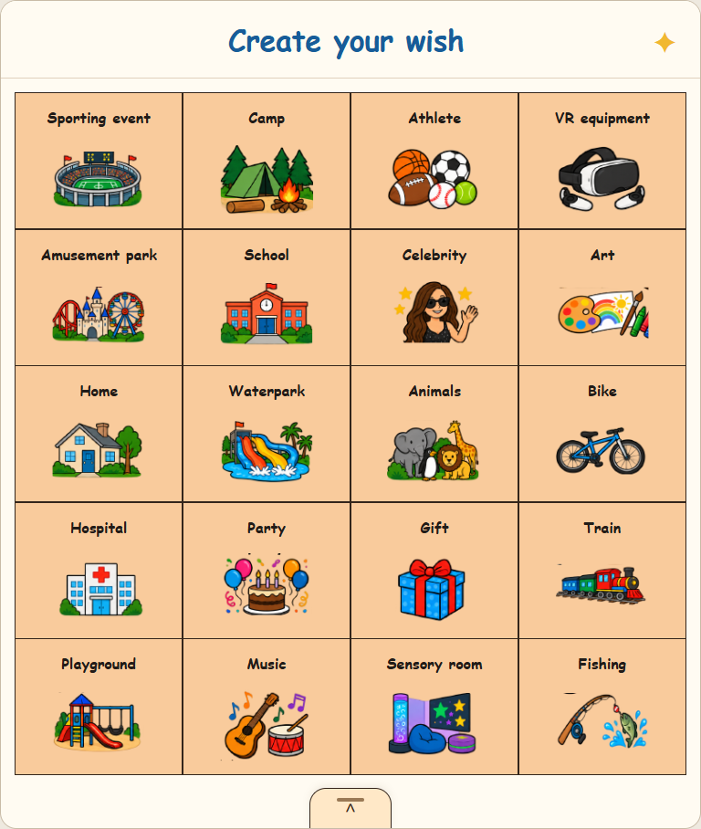
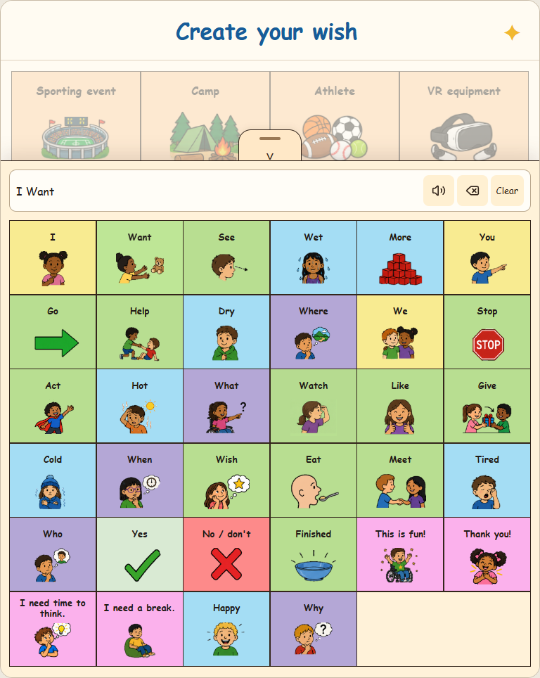
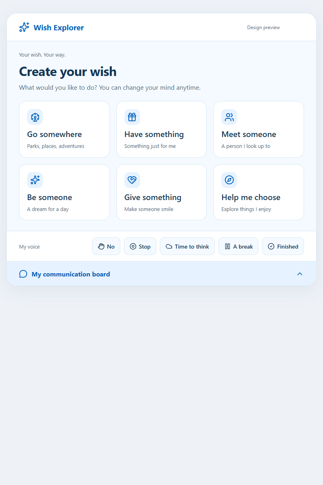

# Picture board: current design and reusable components

The child starts with pictures of interests, rather than being asked to choose a wish verb. The current design uses the 20 noun pictures from the supplied communication-board image. The remaining 34 concepts live in a bottom communication drawer. This document describes that revised design; the screenshot at the end records the earlier six-panel concept only.

## Current home screen

These are browser concept screenshots. Native layout and device behavior still need Mac/iPad verification.

Show the following tiles in this exact reading order: four columns and five rows in the landscape/tablet board arrangement. Keep each picture paired with its short visible label. Responsive layouts may wrap, while preserving the reading order and stable identity of each choice.

| Row | Column 1 | Column 2 | Column 3 | Column 4 |
| --- | --- | --- | --- | --- |
| 1 | sporting event | camp | athlete | VR equipment |
| 2 | amusement park | school | celebrity | art |
| 3 | home | waterpark | animals | bike |
| 4 | hospital | party | gift | train |
| 5 | playground | music | sensory room | fishing |

The tile IDs use the slug form of their labels, such as `sporting-event`, `amusement-park`, `VR equipment` → `vr-equipment`, and `sensory-room`. These are picture-interest IDs, not the API's wish-category IDs.

Selecting `amusement-park` enters the existing `go` park journey, whose destination/color/animal request contract remains unchanged. Other interest tiles must not imply that their complete journeys, fulfillment, or real-time availability are implemented. The local postcard and server postcard are illustrated previews; this revision does not add a generative image service.

Do not add the earlier “Go somewhere / Have something / Meet someone / Be someone / Give something / Help me choose” menu above or below these pictures. Do not repeat the 20 noun interests inside the communication drawer. There is no separate “My voice” quick toolbar.

## `PictureSymbol`

`PictureSymbol` owns the visual symbol for a single stable concept ID. It uses the source picture artwork authorized by the user for the current prototype. Keep the image aspect ratio and meaningful content visible, give it a consistent image area, and avoid stretching or recoloring a symbol in ways that change its meaning. Supply a deliberate fallback for an unavailable asset rather than an empty tile.

The parent tile supplies the spoken/accessible name. A decorative image inside an already-labeled button should not create a second accessibility stop or repeat the label. Use the same concept ID and artwork consistently when a picture appears again later in the journey.

## `PictureTile`

`PictureTile` combines a `PictureSymbol`, visible label, selection state, accessible button behavior, and one selection action. It can be reused for the 20 home-screen interests and for picture choices in later screens without coupling its layout to a particular route.

- Keep the complete tile tappable with a generous target and visible spacing.
- Preserve the label at larger text sizes; a picture or color alone must not carry the meaning.
- Give a selected tile a clear shape/border or check indicator, not color alone.
- Use its concept ID for navigation and data, rather than reading the visible label as an identifier.
- Let the child change a selection or go back. A tap expresses an interest, not medical eligibility, permission, or consent.

## Centered communication drawer

One centered handle at the bottom of the screen opens and closes the drawer. Support both a tap and an up/down drag on that handle. Dragging is an optional convenience: opening or closing the board must never require a gesture that a child cannot perform. Provide an accessible button label and expanded/collapsed state. Keep the drawer available through the existing park journey and postcard screens.

The drawer contains exactly the source board's 54 concepts **minus the 20 noun-interest pictures on the home screen**. Preserve the remaining order. This produces 34 concepts:

| Source row | Core concepts retained in reading order |
| --- | --- |
| 1 | I; want; see; wet; more |
| 2 | You; go; help; dry; where |
| 3 | we; stop; act; hot; what |
| 4 | watch; like; give; cold; when |
| 5 | wish; eat; meet; tired; who |
| 6 | Yes; no/don’t; finished; This is fun!; Thank you!; I need time to think.; I need a break.; happy; why |

These are source-row groupings for checking coverage, not new tabs or redundant categories to add to the child interface. Reuse the communication selection, phrase, speech, clear, pause, and resume behaviors already present in the app. Keep “no/don’t,” “stop,” “finished,” time to think, and a break reachable. Do not convert a refusal or request to pause into a wish choice.

## API boundary and verification status

This is a client UI/component revision. The backend endpoints and tests are unchanged. In particular, `/v1/catalog` still exposes the earlier verb taxonomy for compatibility; it does not supply the revised home board or the drawer's 34-word composition. The app owns that screen definition. `amusement-park` maps to `categoryId: "go"` only when entering the existing park flow; it is not itself a valid backend `categoryId`.

The backend remains a fixed-choice illustrated demo. Native simulator/build testing requires macOS and Xcode and must be reported separately. A browser screenshot is visual evidence of the browser concept, not evidence of an iPad build, native interaction, or TestFlight readiness.

## Archived six-panel concept

The original concept offered six panels: Go somewhere, Have something, Meet someone, Be someone, Give something, and Help me choose. The last panel was a navigation helper, not a sixth official wish category. The screenshot below is preserved unchanged from the earlier preview as design history. It also shows the former “My voice” row and communication-board bar. **Those elements are not acceptance criteria for the revised picture-board home screen.**

The archived image is a byte-for-byte copy of the original `work/preview-home.png` captured before the picture-board revision. Do not overwrite it with a new screen. Add a separately named revised screenshot when that view has been captured and verified.
